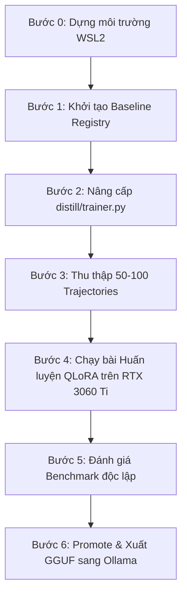

# CHIẾN LƯỢC HUẤN LUYỆN TỰ MINH TRÊN GPU RTX 3060 TI (8GB VRAM)
**Tư vấn chiến lược từ:** Claude Sonnet (GitHub Copilot Pro)
**Thời điểm ghi nhận:** 08:15 PM, 05/10/2026
**Dự án:** Tự Minh (TADP/1 - Multi-Agent Distillation & Self-Evolution)
**Kho mã nguồn:** `G:\TuMinh` | Nhánh: `main` (Tag `v0.1.0`)

---

## Lời tựa: Nguyên lý "Chưng cất hẹp" (Narrow Distillation) & Tính pháp lý

### 1. Đặt mục tiêu thực tế
Một model 7–8B fine-tune QLoRA sẽ **không bao giờ "tiệm cận" Claude Sonnet về tư duy tổng quát**. Khoảng cách này bắt nguồn từ:
- Quy mô tham số (7B–8B so với hàng trăm tỷ tham số).
- Kiến trúc huấn luyện (RLHF nhiều vòng + hàng trăm nghìn giờ compute khổng lồ).
- Độ sâu suy luận và ngữ cảnh (Context & Reasoning depth).

**Điều hoàn toàn khả thi và giá trị nhất:** Thực hiện **Chưng cất hẹp (Narrow Distillation)**:
- Dạy "Tự Minh" bắt chước chuẩn mực định dạng gọi công cụ (**Tool-use format**).
- Rèn luyện quy trình kiểm tra trước khi commit (**Verify-before-commit**).
- Nắm vững phong cách giải quyết các bài toán lập trình thường gặp trong chính không gian làm việc của bạn.

### 2. Lưu ý về bản quyền & Điều khoản dịch vụ (ToS)
- Anthropic ToS cấm sử dụng output của Claude để huấn luyện mô hình thương mại cạnh tranh trực tiếp.
- Việc sử dụng vài chục đến vài trăm mẫu cá nhân để tinh chỉnh trợ lý nội bộ chạy **cục bộ offline, không phân phối** có rủi ro thấp.
- Chuẩn giao thức **TADP/1** của Tự Minh đã bắt buộc khai báo `license_or_authorization` và `authorized_by` ở bước `import-external` để đảm bảo tính minh bạch và an toàn về nguồn gốc dữ liệu.

---

## 1. Lựa chọn Mô hình nền (Base Model)

| Mô hình | Năng lực Code | Định dạng Tool-use | VRAM QLoRA 4-bit (rank 16, seq 2048, batch 1) | Đánh giá & Khuyến nghị |
| :--- | :--- | :--- | :--- | :--- |
| **Qwen2.5-Coder-7B-Instruct** | **Tốt nhất phân khúc 7B** (HumanEval ~88%) | Có sẵn chat template hỗ trợ tool-calling kiểu Hermes/JSON chuẩn | ~6.5 – 7.2 GB | ✅ **LỰA CHỌN SỐ 1 (Khuyên dùng)** |
| **DeepSeek-R1-Distill-Qwen-7B** | Giỏi reasoning nhưng sinh chuỗi CoT quá dài | Không tối ưu cho tool-call ngắn gọn; output dài tốn token & VRAM khi train seq 2048 | ~6.5 – 7.2 GB | ⚠️ Dự phòng nếu muốn thử nghiệm chuỗi suy luận CoT |
| **Llama 3.1 8B Instruct** | Kém hơn Qwen-Coder về mảng code | Tool-use format khác biệt, ít tài liệu agentic coding | ~7.5 – 8.0 GB (sát mép VRAM) | ❌ Không khuyến nghị |
| **Qwen2.5-Coder-14B** | Rất mạnh | Rất tốt | ~14 – 18 GB ngay cả khi chạy 4-bit rank thấp | ❌ Không khả thi trên card 8GB VRAM |

### Vì sao chọn `Qwen2.5-Coder-7B-Instruct`:
- **Bản quyền mở sạch (Apache-2.0):** Tự do dùng cá nhân hoặc thương mại mà không vướng rào cản.
- **Ngữ cảnh gốc lớn (128K):** Dù trong bài train chỉ nạp seq 2048 do giới hạn VRAM Guard, model vẫn có nền tảng ngữ cảnh rộng.
- **Đã pretrain sâu về Code & Function Calling:** Giúp LoRA chỉ cần "định hình phong cách làm việc" chứ không phải dạy lại từ con số 0.

Lệnh khởi tạo Baseline Registry:
```powershell
python -m distill.cli init-active `
  --model-tag baseline-v1 `
  --baseline-model-id Qwen/Qwen2.5-Coder-7B-Instruct `
  --baseline-model-revision <commit-sha-cụ-thể-từ-HuggingFace>
```

---

## 2. Chiến lược thu thập Trajectory theo chuẩn TADP/1

### Nguồn dữ liệu số 1: Runtime của chính Tự Minh (Dogfooding)
Mỗi task Tự Minh tự chạy thành công, có verification pass và self-eval pass, sẽ tự động lưu trong `memory/trajectories/<task-id>.jsonl`. Đây là dữ liệu sạch 100% về pháp lý:
```powershell
python -m distill.cli export-runtime `
  --journal-root memory/trajectories `
  --task-id <task-id> `
  --output distill/data/raw/<task-id>.jsonl
```

### Nguồn dữ liệu số 2: Từ Claude Sonnet (Phiên làm việc cá nhân)
Tự tay review transcript bài giải thành công của Claude trong Orca/IDE, chuyển đổi qua script rồi import:
```powershell
.venv\Scripts\python tools\orca_export_to_tadp1.py `
  --orca-export imports/orca/raw/<task_id>.json `
  --output imports/orca/<task_id>.jsonl

python -m distill.cli import-external `
  --source-name claude `
  --license-or-authorization "Cá nhân, nội bộ, offline, không phân phối" `
  --authorized-by "hungdaimedia-gif" `
  --source-model-id "claude-sonnet-5" `
  --source-model-revision "2026-09" `
  --output distill/data/raw/claude-<task_id>.jsonl `
  imports/orca/<task_id>.jsonl
```

### Số lượng mẫu khuyến nghị:
- **50 – 100 mẫu chất lượng cao:** Đã đủ để model thay đổi phong cách trả lời rõ rệt (tuân thủ TDD, verify trước khi commit, format gọi tool chuẩn).
- **500 – 1.000 mẫu:** Bắt đầu có khả năng khái quát hóa (generalization) tốt hơn qua các dạng task mới chưa gặp.
- **Trên 2.000 mẫu:** Dễ dẫn đến hiện tượng quá khớp (overfit) hoặc quên kiến thức cũ (catastrophic forgetting) nếu dữ liệu không đủ đa dạng. **Chất lượng luôn quan trọng hơn số lượng**.

---

## 3. "Điểm ngọt" (Sweet Spot) tham số QLoRA cho RTX 3060 Ti 8GB

### Hiện trạng trong file `distill/trainer.py`:
Hiện tại lớp `QLoRABackend.train()` đang cố định các giá trị sau:
- `lora_alpha = lora_rank * 2` (tỷ lệ cố định 2x).
- `target_modules = ["q_proj", "k_proj", "v_proj", "o_proj"]` (chỉ có Attention layers, thiếu các tầng MLP `gate_proj`, `up_proj`, `down_proj`).
- `learning_rate = 2e-4`, `num_train_epochs = 1`.

### Bảng tham số cấu hình đề xuất (`config.toml`):

| Tham số | Giá trị đề xuất | Lý do & Ý nghĩa kỹ thuật |
| :--- | :--- | :--- |
| `quantization` | `"4bit"` | Bắt buộc để nạp model 7B vào 8GB VRAM |
| `sequence_length` | `2048` | Mức trần an toàn của VRAM Guard, đủ chứa hầu hết trajectory code |
| `batch_size` | `1` | Bắt buộc cho 8GB VRAM (được bảo vệ bởi VRAM Guard) |
| `gradient_accumulation_steps` | `16` | Tạo ra Effective Batch Size = 16, giúp gradient ổn định mà không ngốn thêm VRAM |
| `lora_rank` | `16` | Mức cân bằng vàng (Rank 8 hơi thấp cho agentic reasoning; Rank 16 cho alpha = 32) |
| `num_train_epochs` | `2 – 3` | Vùng an toàn để model ngấm kiến thức mà không bị overfit |
| `target_modules` | Thêm MLP | Mở rộng sang `gate_proj`, `up_proj`, `down_proj` để tăng năng lực suy luận |

---

## 4. Lộ trình thực chiến từng bước (Từ WSL2 đến Ollama)



### Bước 0: Dựng môi trường training trong Ubuntu WSL2
Chạy trong terminal Ubuntu WSL2 (không chạy trên Windows gốc để đảm bảo CUDA kernels của `bitsandbytes` hoạt động ổn định nhất):
```bash
cd /mnt/g/TuMinh
python3.11 -m venv .venv-train && source .venv-train/bin/activate
pip install -e ".[dev]"
pip install -r distill/requirements-training.txt
nvidia-smi   # Xác nhận GPU RTX 3060 Ti nhận diện đầy đủ
```

### Bước 1: Khởi tạo Baseline Model Registry
```powershell
python -m distill.cli init-active \
  --model-tag baseline-v1 \
  --baseline-model-id Qwen/Qwen2.5-Coder-7B-Instruct \
  --baseline-model-revision <commit-sha-cố-định>
```

### Bước 2: Nâng cấp `distill/trainer.py`
Mở khóa các tham số `num_train_epochs`, `lora_alpha`, và `target_modules` để cấu hình được trong file TOML, bổ sung unit test TDD.

### Bước 3: Thu hoạch 50 – 100 Trajectories đầu tiên
```powershell
# Chắt lọc dữ liệu sạch
python -m distill.cli curate `
  --input distill/data/raw/*.jsonl `
  --output distill/data/curated/dataset-v1.jsonl
```

### Bước 4: Chạy bài Huấn luyện QLoRA thật (trong WSL2)
```bash
python -m distill.cli train \
  --config distill/config.example.toml \
  --dataset distill/data/curated/dataset-v1.jsonl
```

### Bước 5: Đánh giá Benchmark
Chạy plugin evaluator độc lập để so sánh `baseline-v1` và `candidate-v1`:
```powershell
python -m distill.cli benchmark `
  --candidate-manifest distill/models/candidates/candidate-v1/candidate-manifest.json `
  --evaluator my_evaluator:build `
  --output distill/reports/benchmark-v1.json
```

### Bước 6: Phê duyệt (Promote) & Triển khai GGUF vào Ollama
```powershell
python -m distill.cli promote `
  --candidate-id candidate-v1 `
  --report distill/reports/benchmark-v1.json

python -m distill.cli deploy `
  --manifest distill/models/candidates/candidate-v1/candidate-manifest.json `
  --adapter distill/models/candidates/candidate-v1 `
  --converter-script ~/llama.cpp/convert_lora_to_gguf.py `
  --base-model-path ~/models/Qwen2.5-Coder-7B-Instruct `
  --quantization Q4_K_M

ollama run tuminh-candidate-v1
```
